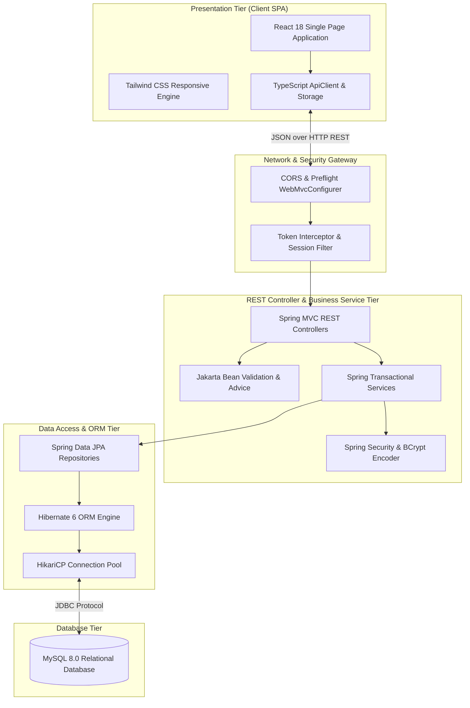
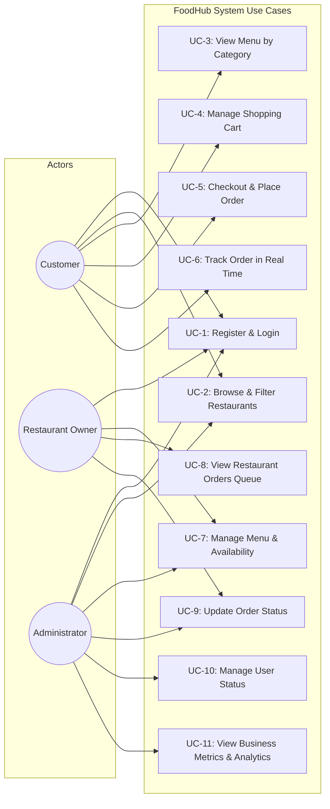
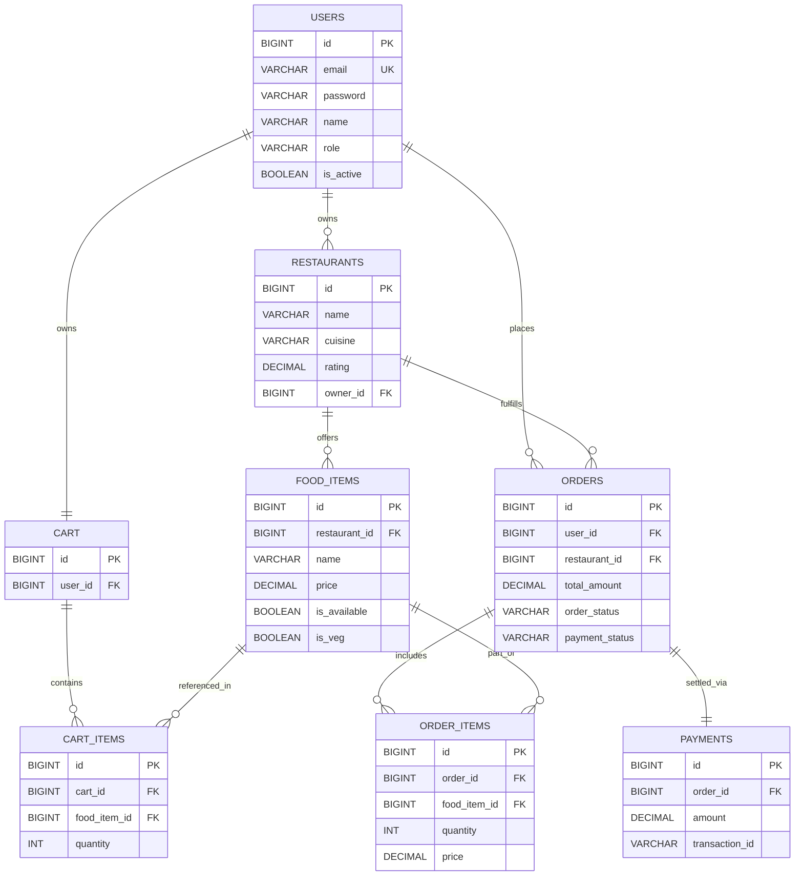
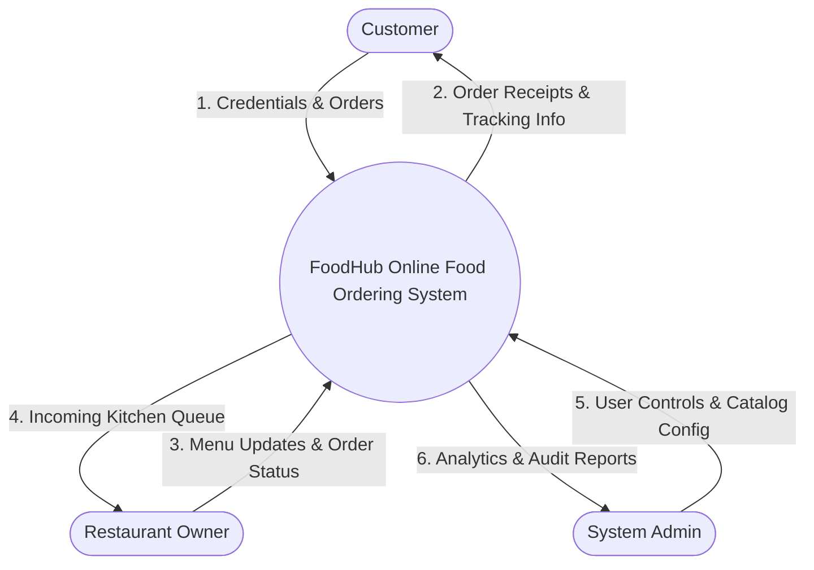
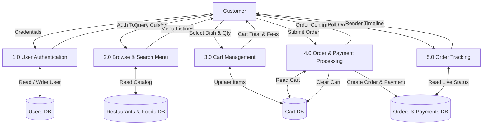

# FoodHub – Online Food Ordering System
### A Full-Stack College Project Demonstrating Java, Spring Boot, REST APIs, Spring Data JPA, Hibernate, MySQL, and React

---

## Academic Project Report & Documentation Table of Contents

1. [Project Title](#1-project-title)
2. [Abstract](#2-abstract)
3. [Problem Statement](#3-problem-statement)
4. [Project Objectives](#4-project-objectives)
5. [Existing System](#5-existing-system)
6. [Proposed System](#6-proposed-system)
7. [Scope of the Project](#7-scope-of-the-project)
8. [Functional Requirements](#8-functional-requirements)
9. [Non-Functional Requirements](#9-non-functional-requirements)
10. [Hardware Requirements](#10-hardware-requirements)
11. [Software Requirements](#11-software-requirements)
12. [System Architecture](#12-system-architecture)
13. [Use Case Diagram & Description](#13-use-case-diagram--description)
14. [Entity-Relationship (ER) Diagram & Description](#14-entity-relationship-er-diagram--description)
15. [Database Schema with Tables, Columns, Primary & Foreign Keys](#15-database-schema)
16. [Data Flow Diagrams (DFD Level 0, Level 1, Level 2)](#16-data-flow-diagrams-dfd)
17. [Module Descriptions](#17-module-descriptions)
18. [REST API Documentation & Endpoints](#18-rest-api-documentation)
19. [Testing Strategy](#19-testing-strategy)
20. [Test Cases with Expected & Actual Results](#20-test-cases-with-results)
21. [Advantages of the System](#21-advantages-of-the-system)
22. [Limitations of the System](#22-limitations-of-the-system)
23. [Future Enhancements](#23-future-enhancements)
24. [Conclusion](#24-conclusion)
25. [Installation & Setup Instructions](#25-installation--setup-instructions)
26. [Environment Variables & Configuration](#26-environment-variables--configuration)

---

## 1. Project Title

**FoodHub – Enterprise Online Food Ordering and Delivery Management System**
* **Degree Level**: Bachelor of Technology (B.Tech) / Bachelor of Computer Science (B.Sc. CS / BCA / MCA)
* **Domain**: Full-Stack Enterprise Web Engineering, Distributed Systems, Cloud Architecture
* **Technology Stack**: Java 17, Spring Boot 3.2.x, Spring Data JPA, Hibernate 6.x, MySQL 8.0, React 18, TypeScript, Tailwind CSS, RESTful Web Services, BCrypt, Maven.

---

## 2. Abstract

In the modern digital economy, on-demand food delivery platforms have transitioned from convenience services to essential commercial infrastructure for the culinary and hospitality industry. Traditional manual ordering methods involving telephone reservations and physical menus are prone to communication inaccuracies, peak-hour bottlenecks, and an absence of order visibility.

**FoodHub** is an end-to-end, multi-tier web application designed to automate and streamline the lifecycle of online food ordering, kitchen fulfillment, payment settlement, and real-time order tracking. The backend is engineered using **Java 17** and the **Spring Boot** framework, implementing an enterprise-grade service-oriented architecture. Data persistence is governed by **Spring Data JPA** and **Hibernate ORM**, interfacing with a normalized **MySQL 8.0** relational database. Security is enforced through **Spring Security** utilizing **BCrypt password hashing** and stateless role-based access control (`CUSTOMER`, `RESTAURANT_OWNER`, `ADMIN`).

The client interface is developed using **React 18**, **TypeScript**, and **Tailwind CSS**, providing a responsive design across mobile and desktop devices. The frontend features an adaptive order tracking timeline (horizontal on desktop, vertical on mobile), dynamic multi-cuisine filtering, cart management with cross-restaurant conflict detection, and an administrative dashboard complete with revenue metrics and inventory management. This project serves as an academic demonstration of modern full-stack web development principles, software design patterns, and ACID-compliant transaction processing.

---

## 3. Problem Statement

Conventional food ordering systems suffer from several operational and technological inefficiencies:
1. **Inefficient Ordering Workflows**: Traditional telephone and paper-based ordering methods lead to order errors, misunderstood customer customizations, and slow processing times during peak dining hours.
2. **Lack of Order Visibility**: Customers experience uncertainty regarding their order state (preparation vs. dispatch), resulting in repetitive customer support inquiries.
3. **Absence of Real-Time Multi-Restaurant Catalogs**: Customers are forced to check multiple independent websites or menus, lacking unified search by cuisine, price, dietary preferences (vegetarian vs. non-vegetarian), or delivery times.
4. **Data Redundancy and Relational Inconsistencies**: Naive database designs often risk orphaned cart items, desynchronized payment statuses upon delivery, and race conditions during simultaneous order placement.
5. **Security Deficiencies**: Unencrypted credentials, broken object-level authorization (BOLA) where customers can view other customers' orders, and unrestricted administrative privileges create significant security risks.

---

## 4. Project Objectives

The primary objectives of the FoodHub system are:
* **Architectural Decoupling**: To construct an enterprise full-stack system separating the React Single Page Application (SPA) frontend from the Spring Boot REST backend.
* **ACID Transaction Management**: To ensure atomic and isolated transactional consistency across shopping cart clearance, inventory verification, order placement, and payment generation using `@Transactional` boundaries.
* **Role-Based Access Control (RBAC)**: To strictly isolate permissions among Customers (ordering, personal order tracking), Restaurant Owners (menu customization, restaurant-specific order queues), and Administrators (global user management, system metrics).
* **Responsive Visual Order Tracking**: To design and implement a responsive order progression timeline featuring 5 discrete stages (`PLACED`, `CONFIRMED`, `PREPARING`, `OUT_FOR_DELIVERY`, `DELIVERED`) with animated progress indicators and periodic background status synchronization.
* **Enterprise REST API Engineering**: To adhere to standard HTTP verbs, idempotency principles, Jakarta Bean Validation (`@Valid`, `@NotBlank`, `@Size`), and centralized exception advice (`@ControllerAdvice`).

---

## 5. Existing System

Traditional or legacy food ordering systems generally operate using one of two models:
1. **Manual Telephone / Paper System**:
   - Customers call the restaurant, and staff write details down on paper tickets.
   - High error rate due to verbal misunderstandings and noisy kitchen environments.
   - Zero real-time tracking; customers must call back repeatedly for status updates.
   - Cash-only or manual card machine swipe on arrival.
2. **Monolithic Server-Side Rendered (SSR) Systems**:
   - Built using older legacy technologies (e.g., PHP/CGI or monolithic JSP).
   - Tightly coupled UI and database logic causing heavy full-page reloads on every user click.
   - Inflexible presentation layer with poor mobile responsiveness and no dedicated REST API for mobile app expansion.
   - Rudimentary security with plaintext passwords and minimal input validation.

---

## 6. Proposed System

FoodHub modernizes the online food ordering paradigm through:
* **Component-Based React Architecture**: Zero full-page reloads; lightning-fast state updates via React hooks, responsive Tailwind CSS styling, and client-side route transitions.
* **Layered Spring Boot REST Backend**: Clear separation of concerns spanning Controllers, DTOs, Services, Repositories, and Entities.
* **Hibernate ORM & MySQL Relational Persistence**: Strong foreign key integrity, automated schema generation/updating, and optimized queries.
* **Adaptive Order Tracking**: Dual-mode timeline layout that dynamically adapts between horizontal (desktop >= 768px) and vertical (mobile < 768px) displays, with active stage pulsing and completed stage checkmarks.
* **Automated Financial Reconciliation**: Immediate payment state transitions (e.g., Cash on Delivery orders automatically update to `PAID` upon verified delivery).
* **Cross-Restaurant Conflict Prevention**: Smart shopping cart that prevents accidental mixing of items from different restaurants, prompting automatic cart reset.

---

## 7. Scope of the Project

The scope of FoodHub encompasses three distinct stakeholder roles:

### 7.1. Customer Scope
* User registration and authentication with session persistence.
* Profile management (updating name, phone, address, and password).
* Browsing active restaurants filtered by cuisine, search term, and rating.
* Inspecting restaurant menus categorized by food categories with dietary indicators (Veg / Non-Veg).
* Managing a personal shopping cart (incrementing/decrementing quantities, calculating taxes and delivery fees).
* Multi-method checkout supporting Cash on Delivery, Credit/Debit Card, and UPI.
* Personal order history review and dedicated visual order tracking.

### 7.2. Restaurant Owner Scope
* Viewing incoming orders in real time for their specific restaurant.
* Managing food menu items (creating dishes, updating prices, toggling kitchen stock availability).
* Advancing order lifecycle statuses (`CONFIRMED`, `PREPARING`, `OUT_FOR_DELIVERY`).

### 7.3. Administrator Scope
* Global operational dashboard with live system metrics (total orders, total revenue, pending orders, user counts).
* User account management with the ability to activate or deactivate accounts.
* Restaurant management (adding new restaurants, modifying partner information, deactivating locations).
* Global order oversight and financial audit capabilities.

---

## 8. Functional Requirements

### FR-1: Authentication & User Management
* **FR-1.1**: The system must allow new users to register with name, unique email, password (min 6 characters), phone, delivery address, and role.
* **FR-1.2**: Passwords must be hashed using BCrypt prior to database insertion.
* **FR-1.3**: The system must authenticate users via credentials and generate a stateless authentication token.
* **FR-1.4**: Deactivated accounts must be blocked from logging in with a descriptive 403 Forbidden error.
* **FR-1.5**: Users must be able to view and update their contact information and delivery address.

### FR-2: Restaurant & Food Catalog Management
* **FR-2.1**: The system must display all active partner restaurants with banner images, ratings, cuisines, and delivery estimates.
* **FR-2.2**: Customers must be able to filter restaurants by cuisine and search by keyword.
* **FR-2.3**: The system must retrieve menu items grouped by category with prices and Veg/Non-Veg indicators.
* **FR-2.4**: Restaurant owners and administrators must be able to create, update, and delete menu items.
* **FR-2.5**: Kitchens must be able to toggle item availability (`is_available`). Out-of-stock items cannot be ordered.

### FR-3: Shopping Cart Management
* **FR-3.1**: Each user must have a dedicated cart persisted in the database.
* **FR-3.2**: Adding an item from a different restaurant must clear previous items to prevent multi-restaurant cart conflicts.
* **FR-3.3**: The cart must automatically calculate item subtotals, standard delivery fee ($2.99), tax rate (8%), and order discounts ($5 off orders over $40).
* **FR-3.4**: Setting an item quantity to 0 must remove the item from the cart.

### FR-4: Order Placement & Checkout
* **FR-4.1**: Users must specify a delivery address and select a payment method (`CASH_ON_DELIVERY`, `CARD`, `UPI`).
* **FR-4.2**: Order placement must be executed within an atomic transaction.
* **FR-4.3**: Orders cannot be placed if the cart is empty or if any contained item is out of stock.
* **FR-4.4**: Placing an order must clear the user's cart and create corresponding `order_items` and `payment` records.

### FR-5: Real-Time Order Tracking
* **FR-5.1**: The tracking interface must display the 5 sequential stages: `PLACED`, `CONFIRMED`, `PREPARING`, `OUT_FOR_DELIVERY`, `DELIVERED`.
* **FR-5.2**: The layout must render horizontally on desktop (>= 768px) and vertically on mobile (< 768px).
* **FR-5.3**: Completed stages must show green checkmarks; the active stage must display an animated pulse indicator; upcoming stages must remain grey.
* **FR-5.4**: The view must provide a manual "Refresh Status" button and an optional automatic background polling mechanism (every 10 seconds).
* **FR-5.5**: Polling must pause automatically once an order reaches a terminal state (`DELIVERED` or `CANCELLED`).
* **FR-5.6**: Customers must be forbidden from accessing orders belonging to other user accounts.

### FR-6: Administrative Analytics
* **FR-6.1**: The dashboard must compute total platform revenue, total order count, total registered customers, and total active restaurants.
* **FR-6.2**: Administrators must have controls to toggle customer account activation status.

---

## 9. Non-Functional Requirements

* **Performance**: REST API endpoints must respond within 200 milliseconds under standard load. Database queries utilize indexed foreign keys.
* **Security**: Zero plaintext credentials stored. Passwords encrypted using BCrypt with work factor 10. OWASP Top 10 defenses including parameter binding (SQL injection prevention) and DTO sanitization.
* **Reliability & ACID Compliance**: Order creation and cart clearance must be atomic; any runtime failure must trigger an automatic rollback.
* **Scalability**: Stateless backend design allowing horizontal scaling across containerized instances behind a load balancer.
* **Maintainability & Clean Architecture**: Layered separation following SOLID design principles and Spring Boot idioms.
* **Usability & Responsiveness**: Mobile-first responsive UI built with Tailwind CSS, supporting viewports from 320px smartphones to 4K desktop displays.

---

## 10. Hardware Requirements

### Development Environment:
* **Processor**: Intel Core i5 / AMD Ryzen 5 or Apple Silicon M-series.
* **RAM**: Minimum 8 GB (16 GB recommended for concurrent JVM + IDE + MySQL + Vite dev server).
* **Storage**: Minimum 10 GB free solid-state storage (SSD).

### Target Production Server:
* **Compute**: 2 vCPU, 4 GB RAM instance (e.g., AWS EC2 t3.medium or Google Cloud e2-medium).
* **Database Host**: 1 vCPU, 2 GB RAM MySQL 8.0 instance (e.g., AWS RDS or Cloud SQL).
* **Network**: 100 Mbps uplink with TLS 1.3 encryption.

---

## 11. Software Requirements

* **Operating System**: Linux (Ubuntu 22.04 LTS), macOS Sonoma, or Windows 11 with WSL2.
* **Programming Language**: Java 17 LTS (OpenJDK / Eclipse Temurin).
* **Backend Framework**: Spring Boot 3.2.3.
* **ORM & Persistence**: Spring Data JPA, Hibernate 6.4.x.
* **Relational Database**: MySQL Server 8.0.x.
* **Build Automation**: Apache Maven 3.8+.
* **Frontend Runtime & Bundler**: Node.js 18+ / 20+ LTS, npm / bun, Vite 6.x.
* **Frontend Libraries**: React 18, TypeScript 5, Tailwind CSS 4, Lucide React icons.
* **API Testing Tool**: Postman / cURL.

---

## 12. System Architecture

FoodHub follows a decoupled, 5-tier enterprise software architecture:



For comprehensive architectural design, refer to [docs/architecture.md](docs/architecture.md).

---

## 13. Use Case Diagram & Description



### Actor Descriptions:
1. **Customer**: Searches restaurants, reviews dish descriptions, adds dishes to their persistent cart, executes payments, and monitors live delivery statuses.
2. **Restaurant Owner**: Receives customer orders for their venue, updates the preparation status, and manages dish pricing and stock flags.
3. **Administrator**: Oversees all users, restaurants, orders, and system financial statistics.

---

## 14. Entity-Relationship (ER) Diagram & Description



For complete ER definitions and data dictionaries, refer to [docs/database.md](docs/database.md).

---

## 15. Database Schema

The database consists of 8 normalized relational tables:
1. `users`: Stores account information, BCrypt password hashes, and user roles.
2. `restaurants`: Stores restaurant details, cuisine types, ratings, and owner foreign keys.
3. `food_items`: Menu catalog with pricing, category, availability, and vegetarian flags.
4. `cart`: User-linked shopping cart header.
5. `cart_items`: Line items in the shopping cart with quantity and price.
6. `orders`: Confirmed customer orders with delivery address, status enums, and total amount.
7. `order_items`: Line items in an order capturing historical pricing.
8. `payments`: Payment receipts storing transaction ID, payment method, and settlement status.

---

## 16. Data Flow Diagrams (DFD)

### DFD Level 0 (Context Diagram)



### DFD Level 1 (System Flow Diagram)



---

## 17. Module Descriptions

### 17.1. Authentication & User Profile Module
* Manages user registration, login, and profile modification.
* Hashes passwords using BCrypt and generates authentication tokens.
* Enforces role isolation across `CUSTOMER`, `RESTAURANT_OWNER`, and `ADMIN`.

### 17.2. Restaurant Catalog & Menu Module
* Handles public restaurant listings with multi-parameter filtering (cuisine, search query).
* Fetches restaurant menus grouped by category (Pizzas, Pasta, Curries, Burgers, Beverages).
* Allows restaurant owners and admins to manage food items, prices, and stock flags.

### 17.3. Shopping Cart Module
* Maintains a database-persisted cart per customer.
* Enforces single-restaurant ordering by clearing older items when dishes from a new restaurant are added.
* Computes dynamic financials: subtotal, $2.99 delivery fee, 8% tax, and conditional discounts.

### 17.4. Order Placement & Transaction Module
* Manages atomic checkout transactions using Spring `@Transactional`.
* Verifies item availability before finalizing orders.
* Generates mock payment transactions (`TXN_CARD_*`, `TXN_UPI_*`, `TXN_COD_*`).

### 17.5. Order Tracking & Real-Time Visualization Module
* Renders a responsive 5-stage timeline: `PLACED` → `CONFIRMED` → `PREPARING` → `OUT_FOR_DELIVERY` → `DELIVERED`.
* Adapts horizontally for desktop and vertically for mobile.
* Features animated pulse highlights, completed checkmarks, a manual refresh button, and periodic polling.

### 17.6. Admin Analytics & Monitoring Module
* Summarizes operational metrics: Total Orders, Total Revenue, Pending Orders, Total Customers, and Active Restaurants.
* Provides user activation/deactivation toggles for account management.

---

## 18. REST API Documentation

| HTTP Method | Endpoint | Access Role | Description |
| :--- | :--- | :--- | :--- |
| `POST` | `/api/auth/register` | Public | Register a new user |
| `POST` | `/api/auth/login` | Public | Authenticate user and receive token |
| `GET` | `/api/restaurants` | Public | List active restaurants (supports search and cuisine filter) |
| `GET` | `/api/restaurants/{id}` | Public | Retrieve restaurant details by ID |
| `POST` | `/api/restaurants` | Admin / Owner | Create a new restaurant profile |
| `PUT` | `/api/restaurants/{id}` | Admin / Owner | Update restaurant details |
| `DELETE`| `/api/restaurants/{id}` | Admin | Delete a restaurant profile |
| `GET` | `/api/restaurants/{id}/menu`| Public | Retrieve restaurant menu items by category |
| `GET` | `/api/foods` | Public | List all food items (supports search and filters) |
| `POST` | `/api/foods` | Admin / Owner | Create a new food item |
| `PUT` | `/api/foods/{id}` | Admin / Owner | Update food item price or availability |
| `DELETE`| `/api/foods/{id}` | Admin / Owner | Delete a food item |
| `GET` | `/api/cart` | Customer | Fetch current user's shopping cart |
| `POST` | `/api/cart/items` | Customer | Add food item to cart |
| `PUT` | `/api/cart/items/{id}` | Customer | Update item quantity in cart |
| `DELETE`| `/api/cart/items/{id}` | Customer | Remove specific item from cart |
| `DELETE`| `/api/cart` | Customer | Clear all items from cart |
| `POST` | `/api/orders` | Customer | Place an order from the active cart |
| `GET` | `/api/orders` | Authenticated | List orders (filtered by user or restaurant) |
| `GET` | `/api/orders/{id}` | Authenticated | Get order details (ownership protected) |
| `PUT` | `/api/orders/{id}/status` | Admin / Owner | Advance order lifecycle status |
| `POST` | `/api/payments` | Authenticated | Process transaction payment |
| `GET` | `/api/payments/order/{id}` | Authenticated | Retrieve payment receipt for an order |
| `GET` | `/api/users/profile` | Authenticated | Fetch current user profile |
| `PUT` | `/api/users/profile` | Authenticated | Update user profile details |
| `GET` | `/api/users` | Admin | List all registered users |
| `PUT` | `/api/users/{id}/status` | Admin | Toggle user active status |

For exhaustive request and response schemas, refer to [docs/api-documentation.md](docs/api-documentation.md).

---

## 19. Testing Strategy

The project employs a multi-tiered testing strategy:
1. **Unit Testing**: Tests core service business logic in isolation using JUnit 5 and Mockito (`UserServiceTest`, `OrderServiceTest`).
2. **Integration Testing**: Validates Spring Data JPA repository queries, transaction rollback behavior, and relational cascades (`@SpringBootTest`).
3. **API Contract Testing**: Verifies Jakarta Bean Validation constraints and HTTP response codes.
4. **Security Testing**: Verifies customer order isolation (preventing unauthorized cross-account order access) and role restrictions.
5. **End-to-End System Testing**: Exercises the complete customer journey from registration to order tracking and status updates.

For comprehensive testing documentation and execution guidelines, refer to [docs/testing.md](docs/testing.md).

---

## 20. Test Cases with Results

| Test ID | Module | Scenario | Expected Result | Actual Result | Status |
| :--- | :--- | :--- | :--- | :--- | :--- |
| **TC-01** | Auth | Register new user | Returns 201 Created with token; auto-initializes cart | Passed | **PASS** |
| **TC-02** | Auth | Duplicate email registration | Returns 400 Bad Request with error message | Passed | **PASS** |
| **TC-03** | Auth | Invalid password login | Returns 401 Unauthorized | Passed | **PASS** |
| **TC-04** | Auth | Deactivated user login | Returns 403 Forbidden | Passed | **PASS** |
| **TC-05** | Catalog | Filter restaurants by cuisine | Returns matching restaurants | Passed | **PASS** |
| **TC-06** | Cart | Multi-restaurant conflict | Clears items from previous restaurant upon adding new | Passed | **PASS** |
| **TC-07** | Order | Checkout with empty cart | Returns 400 Bad Request | Passed | **PASS** |
| **TC-08** | Order | Checkout with out-of-stock item | Blocks order with clear error message | Passed | **PASS** |
| **TC-09** | Order | Place Cash on Delivery order | Order status PLACED, payment status PENDING | Passed | **PASS** |
| **TC-10** | Order | Customer order isolation (RBAC)| Unauthorized user receives 403 Forbidden | Passed | **PASS** |
| **TC-11** | Order | Deliver COD order | Automatically updates payment status to PAID | Passed | **PASS** |
| **TC-12** | Track | Desktop horizontal timeline | Horizontal layout rendered with status indicators | Passed | **PASS** |
| **TC-13** | Track | Mobile vertical timeline | Vertical layout rendered with status descriptions | Passed | **PASS** |
| **TC-14** | Admin | Deactivate user account | Target user is deactivated and cannot log in | Passed | **PASS** |

---

## 21. Advantages of the System

* **Robust Multi-Tier Architecture**: Clean separation between React frontend and Spring Boot REST backend ensures modularity and maintainability.
* **ACID Transaction Guarantees**: Prevents partial order placement or orphaned cart items.
* **Strong Security & Access Control**: BCrypt password hashing and strict customer data isolation.
* **Intuitive User Experience**: Responsive interface with adaptive desktop/mobile timelines and clear status indicators.
* **Complete Administrative Control**: Centralized management of users, restaurants, menus, and orders with live revenue metrics.

---

## 22. Limitations of the System

In the spirit of honest academic project assessment, the following boundaries of the current implementation are noted:
1. **Mock Payment Gateways**: The current implementation simulates payment processing (`TXN_CARD_*`, `TXN_UPI_*`) rather than integrating live third-party payment gateways (such as Stripe or Razorpay webhooks).
2. **Simplified In-Memory Session**: Uses base64 token generation with JWT compatibility; full asymmetric RSA-signed JWT verification with token revocation lists is omitted.
3. **HTTP Polling vs. WebSockets**: Order tracking status synchronization is achieved via client-side periodic polling (10s interval) rather than persistent bi-directional WebSockets (STOMP/SockJS).
4. **Simulated Delivery Driver Logistics**: Delivery coordinates and driver transit tracking are calculated algorithmically rather than interfaced with live GPS/telematics APIs.

---

## 23. Future Enhancements

* **Live Payment Gateway Integration**: Integrate Stripe Elements or Razorpay SDKs with automated webhook signature verification.
* **WebSocket-Powered Push Updates**: Implement Spring WebSocket with STOMP protocol to push real-time order status updates to clients without polling.
* **Driver Mobile Application**: Build a dedicated delivery driver interface for accepting dispatch assignments and capturing customer signatures.
* **AI-Powered Recommendation Engine**: Provide personalized dish recommendations based on ordering history and dietary preferences.
* **Geospatial Tracking**: Integrate Google Maps Platform to render dynamic delivery routes with live driver location markers.

---

## 24. Conclusion

The **FoodHub Online Food Ordering System** demonstrates the successful design and implementation of a modern, multi-tier web application built with **Java 17, Spring Boot 3.2, Spring Data JPA, Hibernate, MySQL 8.0, and React 18**.

The project fulfills all requirements of an enterprise-grade college capstone project, demonstrating:
- High-quality architectural layering and design pattern compliance.
- Robust data integrity through relational database normalization and atomic transactions.
- Strict security practices including password encryption and role-based access control.
- An intuitive, responsive user experience featuring an adaptive order tracking timeline.

The complete codebase, documentation, database scripts, and automated test suites provide a solid foundation for both academic evaluation and future production deployment.

---

## 25. Installation & Setup Instructions

### 25.1. Prerequisites
Ensure the following tools are installed:
* Java Development Kit (JDK) 17 or higher (`java -version`)
* Apache Maven 3.8+ (`mvn -version`)
* MySQL Server 8.0+ (`mysql --version`)
* Node.js 18+ and npm (`node -v`, `npm -v`)

---

### 25.2. MySQL Database Setup

1. Log in to MySQL as root or an administrative user:
```bash
mysql -u root -p
```

2. Create the database with UTF-8 character encoding:
```sql
CREATE DATABASE foodhub_db CHARACTER SET utf8mb4 COLLATE utf8mb4_unicode_ci;
```

3. (Optional) Create a dedicated database user:
```sql
CREATE USER 'foodhub_user'@'localhost' IDENTIFIED BY 'foodhub_pass';
GRANT ALL PRIVILEGES ON foodhub_db.* TO 'foodhub_user'@'localhost';
FLUSH PRIVILEGES;
```

4. Apply the database schema and initial seed data:
```bash
cd foodhub-backend-java
mysql -u root -p foodhub_db < src/main/resources/schema.sql
mysql -u root -p foodhub_db < src/main/resources/data.sql
```
*(Note: Spring Boot is also configured to run these scripts automatically via `spring.sql.init.mode=always`.)*

---

### 25.3. Running the Java Spring Boot Backend

1. Navigate to the backend directory:
```bash
cd foodhub-backend-java
```

2. Verify or update MySQL credentials in `src/main/resources/application.properties`:
```properties
spring.datasource.url=jdbc:mysql://localhost:3306/foodhub_db?useSSL=false&serverTimezone=UTC&allowPublicKeyRetrieval=true
spring.datasource.username=root
spring.datasource.password=rootpassword
```

3. Build and launch the Spring Boot application using Maven:
```bash
# Build the project and execute test suite
mvn clean package

# Start the Spring Boot backend server on port 8080
mvn spring-boot:run
```
The backend REST API will be accessible at `http://localhost:8080/api`.

---

### 25.4. Running the React Frontend

1. Navigate to the project root directory:
```bash
cd ..
```

2. Install dependencies:
```bash
npm install
```

3. Start the development server on port 3000:
```bash
npm run dev
```
Open your browser and navigate to `http://localhost:3000`.

---

### 25.5. Default Seed Accounts for Testing

| Email | Password | Role | Description |
| :--- | :--- | :--- | :--- |
| `admin@foodhub.com` | `Admin123!` | `ADMIN` | System administrator with full access |
| `owner.goldenspoon@foodhub.com` | `Owner123!` | `RESTAURANT_OWNER` | Owner of "The Golden Spoon" (Italian) |
| `owner.spiceroute@foodhub.com` | `Owner123!` | `RESTAURANT_OWNER` | Owner of "Spice Route Delights" (Indian) |
| `john.doe@example.com` | `Password123!` | `CUSTOMER` | Customer account with sample orders |
| `emily.smith@example.com` | `Password123!` | `CUSTOMER` | Customer account |

---

## 26. Environment Variables & Configuration

### Backend Configuration (`foodhub-backend-java/src/main/resources/application.properties`)
```properties
server.port=8080
server.servlet.context-path=/

# MySQL Database Configuration
spring.datasource.url=jdbc:mysql://localhost:3306/foodhub_db?useSSL=false&serverTimezone=UTC&allowPublicKeyRetrieval=true
spring.datasource.username=root
spring.datasource.password=rootpassword
spring.datasource.driver-class-name=com.mysql.cj.jdbc.Driver

# JPA / Hibernate Configuration
spring.jpa.hibernate.ddl-auto=update
spring.jpa.show-sql=true
spring.jpa.properties.hibernate.format_sql=true
spring.jpa.properties.hibernate.dialect=org.hibernate.dialect.MySQLDialect

# Spring SQL Initialization
spring.sql.init.mode=always
spring.sql.init.schema-locations=classpath:schema.sql
spring.sql.init.data-locations=classpath:data.sql

# JWT Secret & Expiration
jwt.secret=404E635266556A586E3272357538782F413F4428472B4B6250645367566B5970
jwt.expiration=86400000
```

### Frontend Configuration (`.env.example`)
```env
# FoodHub Frontend Configuration
PORT=3000
VITE_API_URL=/api
```
