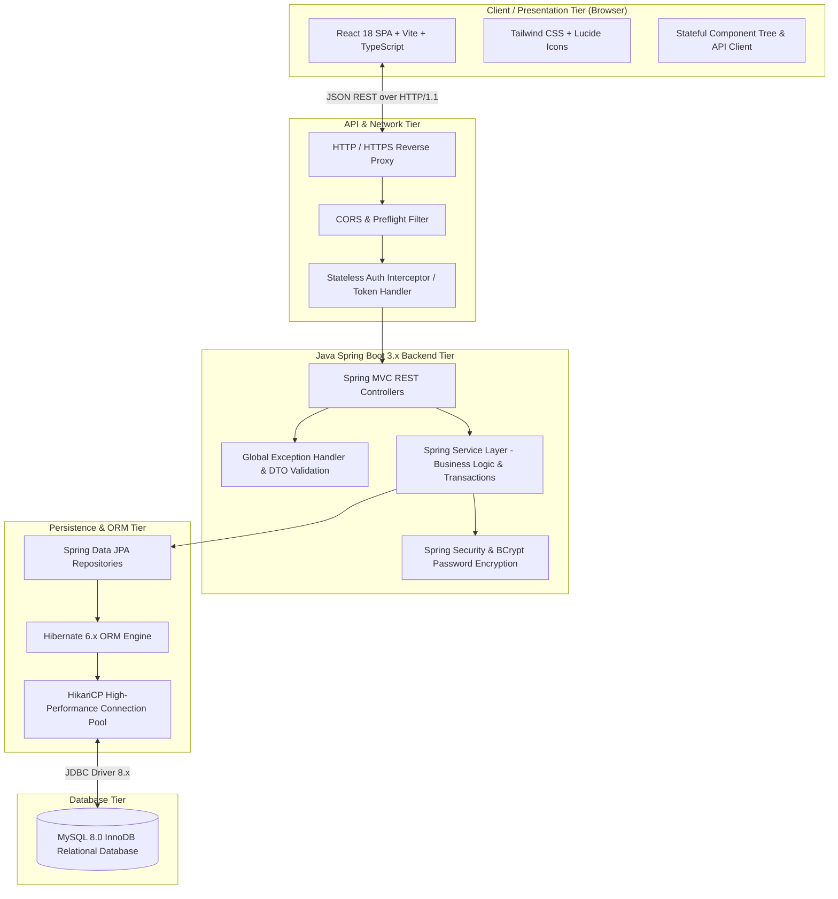
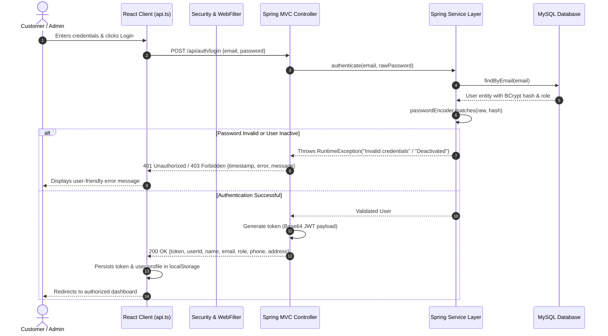
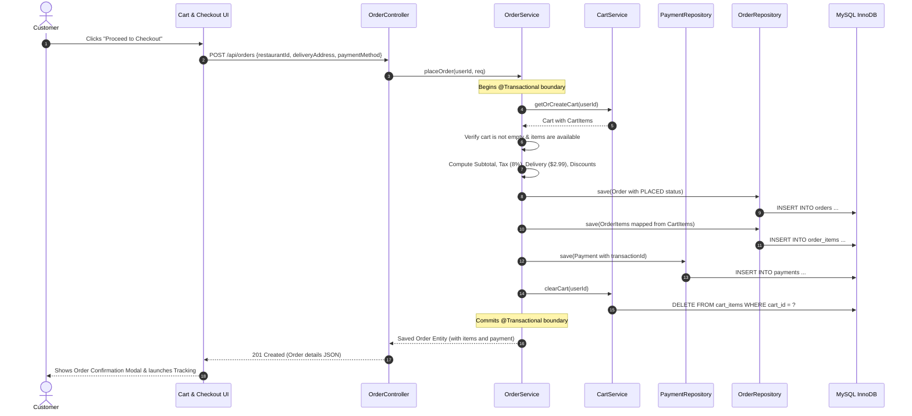
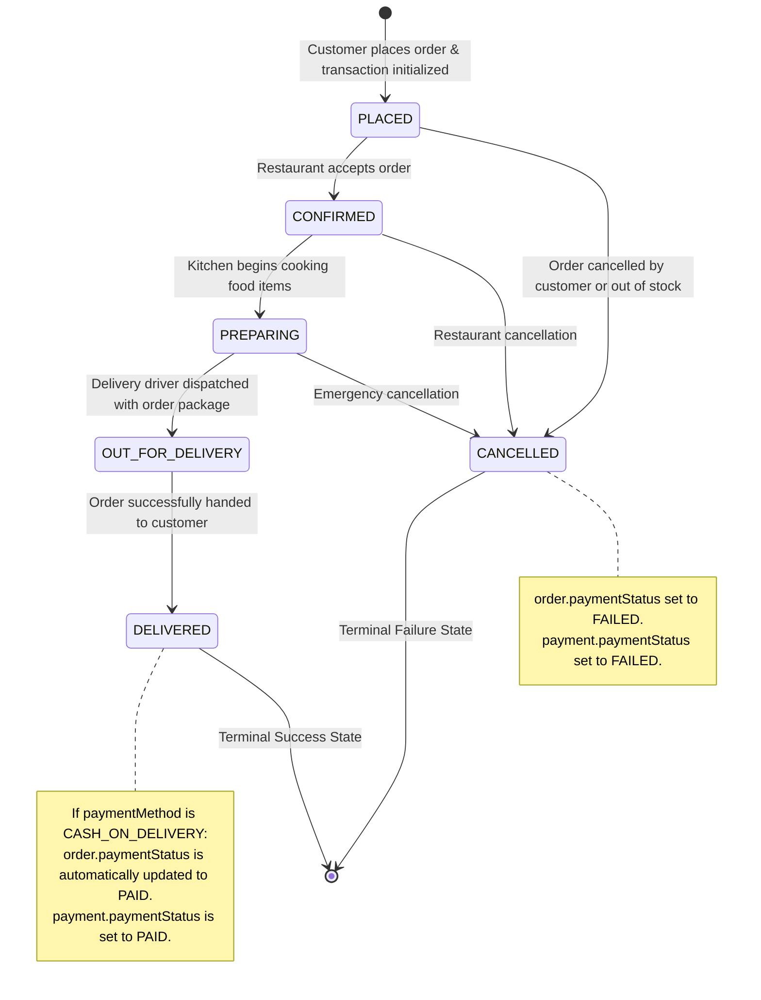

# System Architecture Documentation

## FoodHub – Online Food Ordering System

---

## 1. Architectural Overview

FoodHub is architected as an enterprise-grade, multi-tier full-stack web application designed for high cohesion, low coupling, horizontal scalability, and strict security isolation. The application adheres to modern cloud-ready design principles, decoupling the Presentation Layer (Client SPA) from the Backend Service Layer (REST APIs) and Database Persistence Layer (MySQL RDBMS).

---

## 2. Layered Architecture Details

The system is organized into five distinct layers:

### 2.1. Presentation Layer (Frontend SPA)
* **Technology**: React 18, TypeScript, Tailwind CSS, Lucide React icons.
* **Responsibilities**:
  * Providing responsive user interfaces tailored for mobile, tablet, and desktop screens.
  * Maintaining client-side application state (authenticated user, active cart items, active modal views, order tracking polling timers).
  * Executing asynchronous HTTP communication via `src/api.ts` with transparent authentication header injection (`Authorization: Bearer <token>`, `x-user-id: <id>`).
  * Enforcing client-side navigation between Customer storefront, Admin control panel, Restaurant Owner dashboard, Order History, and Real-Time Order Tracking.

### 2.2. REST API Controller Layer
* **Technology**: Spring MVC `@RestController`, `@RequestMapping`, `@CrossOrigin`.
* **Classes**:
  * `AuthController` (`/api/auth`): Handles user registration, credentials authentication, and token issuance.
  * `RestaurantController` (`/api/restaurants`): Handles restaurant listings, search, filtering, and CRUD operations.
  * `FoodItemController` (`/api/foods`): Handles food catalog items, categories, pricing, availability toggling, and CRUD operations.
  * `CartController` (`/api/cart`): Handles user-specific shopping cart retrieval, item additions, quantity modifications, item deletion, and cart clearing.
  * `OrderController` (`/api/orders`): Handles order creation, customer-isolated order retrieval, restaurant order queue, and authorized status transitions.
  * `PaymentController` (`/api/payments`): Handles payment processing, mock transaction ID generation, and transaction receipt lookup.
  * `UserController` (`/api/users`): Handles user profile retrieval, profile updates, administrative user listing, and account activation/deactivation.

### 2.3. Service / Business Logic Layer
* **Technology**: Spring `@Service`, `@Transactional` declarative transaction management.
* **Responsibilities**:
  * **Domain Validation**: Checks whether items in the shopping cart belong to the same restaurant; verifies that food items are currently marked as available before placing an order.
  * **Financial Calculations**: Calculates item subtotal, standard delivery fee ($2.99), tax rate (8%), and conditional discounts ($5.00 discount on orders exceeding $40.00).
  * **State Transitions**: Validates order state progression (`PLACED` → `CONFIRMED` → `PREPARING` → `OUT_FOR_DELIVERY` → `DELIVERED`). Synchronizes Cash-on-Delivery payment statuses to `PAID` upon verified delivery, and marks transactions `FAILED` if an order is cancelled.
  * **Atomic Transactions**: Guarantees all-or-nothing execution across order creation, order item persistence, payment record generation, and cart purging.

### 2.4. Data Access / ORM Layer
* **Technology**: Spring Data JPA, Hibernate 6.x, `@Repository` interfaces extending `JpaRepository<T, ID>`.
* **Repositories**:
  * `UserRepository`: Derived queries (`findByEmail`, `existsByEmail`).
  * `RestaurantRepository`: Derived queries (`findByIsActiveTrue`, `findByOwnerId`) and JPQL search queries.
  * `FoodItemRepository`: Derived queries (`findByRestaurantIdAndCategory`, `findByRestaurantIdAndIsAvailableTrue`) and JPQL dynamic search.
  * `CartRepository` & `CartItemRepository`: Cart persistence and item cascade deletion.
  * `OrderRepository` & `OrderItemRepository`: Chronologically sorted order queries (`findByUserIdOrderByCreatedAtDesc`, `findByRestaurantIdOrderByCreatedAtDesc`).
  * `PaymentRepository`: One-to-one order payment lookup (`findByOrderId`).

### 2.5. Persistence Tier
* **Technology**: MySQL 8.0 relational database with the InnoDB storage engine.
* **Responsibilities**: ACID transaction guarantee, relational foreign key constraints with cascading rules (`ON DELETE CASCADE`, `ON DELETE SET NULL`), and persistent data indexing.

---

## 3. Security Architecture & Authorization

### Security Measures Implemented:
1. **Password Encryption**: All user passwords are encrypted using BCrypt one-way hashing with salt factor 10. Passwords are never stored or logged in plain text.
2. **DTO Level Password Masking**: `@JsonProperty(access = JsonProperty.Access.WRITE_ONLY)` prevents password hashes from being serialized into any outgoing JSON response.
3. **Stateless Token Authentication**: Client includes `Authorization: Bearer <token>` and `x-user-id` on protected REST calls.
4. **Role-Based Access Control (RBAC)**:
   - `CUSTOMER`: Can view restaurants and menus, manage their own cart, place orders, view only their own orders, and track their active deliveries.
   - `RESTAURANT_OWNER`: Can manage their restaurant details, update their food menu, toggle food availability, and update the status of incoming orders for their restaurant.
   - `ADMIN`: Full administrative privileges across all system records; can manage all restaurants, food items, view global order queues, inspect payments, toggle user account active status, and access administrative business analytics.
5. **CORS Configuration**: Configured in `WebConfig.java` to permit controlled origins with credentials support for all HTTP verbs (`GET`, `POST`, `PUT`, `DELETE`, `OPTIONS`).

---

## 4. End-to-End System Workflows

### 4.1. Order Placement and Transaction Processing Sequence

### 4.2. Order Status Lifecycle State Machine

---

## 5. High-Availability & Deployment Topology

In a production college campus or cloud deployment environment:
1. **Frontend Tier**: Pre-compiled production static bundle served via NGINX or embedded Vite Express proxy with HTTP caching headers.
2. **Application Tier**: Spring Boot executable JAR running on Java 17+ Virtual Machine (JVM), managed via systemd service or Docker container.
3. **Database Tier**: MySQL 8.0 server with automated daily dumps, InnoDB transactional buffer pools, and utf8mb4 collation support.
4. **Monitoring**: Standard Spring Boot health endpoints and structured loggers.
