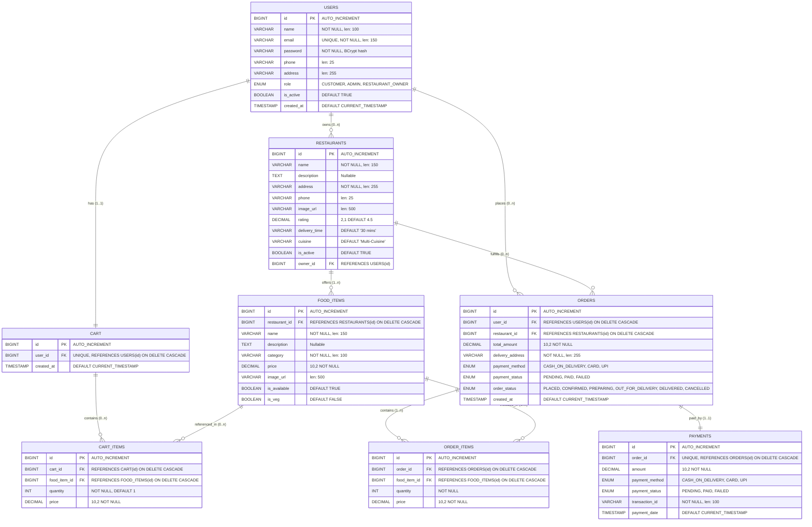

# Database Design & Schema Documentation

## FoodHub – Online Food Ordering System

---

## 1. Database Overview

The FoodHub system utilizes **MySQL 8.0** with the **InnoDB** storage engine to provide full ACID compliance, foreign key relational integrity, atomic transactions, and row-level locking. The schema is normalized up to the **Third Normal Form (3NF)** to eliminate data redundancy while maintaining high query throughput.

### Connection & Dialect Configuration
* **Database Name**: `foodhub_db`
* **Character Set & Collation**: `utf8mb4` with `utf8mb4_unicode_ci` (full multilingual and emoji support)
* **JDBC Driver**: `com.mysql.cj.jdbc.Driver`
* **Hibernate Dialect**: `org.hibernate.dialect.MySQLDialect`
* **Connection Pool**: HikariCP (maximum 10 connections, minimum idle 5, connection timeout 30,000ms)

---

## 2. Entity-Relationship (ER) Diagram



---

## 3. Data Dictionary & Table Specifications

### 3.1. Table: `users`
Stores user profile information, authentication credentials, and system roles.

| Column | Data Type | Nullable | Default | Constraints | Description |
| :--- | :--- | :--- | :--- | :--- | :--- |
| `id` | `BIGINT` | No | Auto Increment | `PRIMARY KEY` | Unique identifier for each user |
| `name` | `VARCHAR(100)` | No | None | None | Full legal name of user |
| `email` | `VARCHAR(150)` | No | None | `UNIQUE` | User login email address |
| `password` | `VARCHAR(255)` | No | None | None | BCrypt salted hash of password |
| `phone` | `VARCHAR(25)` | Yes | NULL | None | Contact telephone number |
| `address` | `VARCHAR(255)` | Yes | NULL | None | Default physical delivery address |
| `role` | `ENUM(...)` | No | `'CUSTOMER'` | Values: `CUSTOMER`, `ADMIN`, `RESTAURANT_OWNER` | Access control role |
| `is_active` | `BOOLEAN` | No | `TRUE` | None | Account status toggle |
| `created_at` | `TIMESTAMP` | Yes | `CURRENT_TIMESTAMP` | None | Account creation timestamp |

---

### 3.2. Table: `restaurants`
Stores restaurant profiles, cuisine categories, physical location, and contact details.

| Column | Data Type | Nullable | Default | Constraints | Description |
| :--- | :--- | :--- | :--- | :--- | :--- |
| `id` | `BIGINT` | No | Auto Increment | `PRIMARY KEY` | Unique restaurant ID |
| `name` | `VARCHAR(150)` | No | None | None | Brand name of restaurant |
| `description`| `TEXT` | Yes | NULL | None | Detailed restaurant biography |
| `address` | `VARCHAR(255)` | No | None | None | Restaurant street address |
| `phone` | `VARCHAR(25)` | Yes | NULL | None | Order inquiry telephone |
| `image_url` | `VARCHAR(500)` | Yes | NULL | None | Banner/card image link |
| `rating` | `DECIMAL(2,1)` | Yes | `4.5` | Min: 0.0, Max: 5.0 | Average customer rating |
| `delivery_time`| `VARCHAR(50)`| Yes | `'30 mins'` | None | Estimated delivery window |
| `cuisine` | `VARCHAR(100)` | Yes | `'Multi-Cuisine'` | None | Primary cuisine category |
| `is_active` | `BOOLEAN` | Yes | `TRUE` | None | Operational status toggle |
| `owner_id` | `BIGINT` | Yes | NULL | `FOREIGN KEY (owner_id) REFERENCES users(id) ON DELETE SET NULL` | Assigned restaurant owner ID |

---

### 3.3. Table: `food_items`
Catalog of dishes, categories, pricing, dietary indicators, and stock availability.

| Column | Data Type | Nullable | Default | Constraints | Description |
| :--- | :--- | :--- | :--- | :--- | :--- |
| `id` | `BIGINT` | No | Auto Increment | `PRIMARY KEY` | Food item identifier |
| `restaurant_id`| `BIGINT` | No | None | `FOREIGN KEY REFERENCES restaurants(id) ON DELETE CASCADE` | Associated restaurant |
| `name` | `VARCHAR(150)` | No | None | None | Dish title |
| `description`| `TEXT` | Yes | NULL | None | Ingredients and dish description |
| `category` | `VARCHAR(100)` | No | None | None | Menu category (e.g., Pizzas, Ramen) |
| `price` | `DECIMAL(10,2)`| No | None | Check: `price >= 0` | Dish unit price in USD |
| `image_url` | `VARCHAR(500)` | Yes | NULL | None | Food image web link |
| `is_available`| `BOOLEAN` | Yes | `TRUE` | None | Real-time kitchen in-stock flag |
| `is_veg` | `BOOLEAN` | Yes | `FALSE` | None | Vegetarian dietary indicator |

---

### 3.4. Table: `cart`
Shopping cart instance tied to an individual user.

| Column | Data Type | Nullable | Default | Constraints | Description |
| :--- | :--- | :--- | :--- | :--- | :--- |
| `id` | `BIGINT` | No | Auto Increment | `PRIMARY KEY` | Cart ID |
| `user_id` | `BIGINT` | No | None | `UNIQUE`, `FOREIGN KEY REFERENCES users(id) ON DELETE CASCADE` | Owning customer ID |
| `created_at` | `TIMESTAMP` | Yes | `CURRENT_TIMESTAMP` | None | Creation timestamp |

---

### 3.5. Table: `cart_items`
Individual items and quantities currently staged inside a customer's cart.

| Column | Data Type | Nullable | Default | Constraints | Description |
| :--- | :--- | :--- | :--- | :--- | :--- |
| `id` | `BIGINT` | No | Auto Increment | `PRIMARY KEY` | Cart item ID |
| `cart_id` | `BIGINT` | No | None | `FOREIGN KEY REFERENCES cart(id) ON DELETE CASCADE` | Parent cart ID |
| `food_item_id`| `BIGINT` | No | None | `FOREIGN KEY REFERENCES food_items(id) ON DELETE CASCADE` | Referenced dish |
| `quantity` | `INT` | No | `1` | Check: `quantity > 0` | Selected quantity |
| `price` | `DECIMAL(10,2)`| No | None | Snapshot unit price | Unit price at time of selection |

---

### 3.6. Table: `orders`
Immutable record of confirmed customer orders.

| Column | Data Type | Nullable | Default | Constraints | Description |
| :--- | :--- | :--- | :--- | :--- | :--- |
| `id` | `BIGINT` | No | Auto Increment | `PRIMARY KEY` | Unique Order ID |
| `user_id` | `BIGINT` | No | None | `FOREIGN KEY REFERENCES users(id) ON DELETE CASCADE` | Ordering customer ID |
| `restaurant_id`| `BIGINT`| No | None | `FOREIGN KEY REFERENCES restaurants(id) ON DELETE CASCADE` | Fulfilling restaurant ID |
| `total_amount` | `DECIMAL(10,2)`| No | None | Total with taxes & fees | Final billed currency amount |
| `delivery_address`|`VARCHAR(255)`| No| None | None | Delivery destination address |
| `payment_method`| `ENUM(...)` | No | None | Values: `CASH_ON_DELIVERY`, `CARD`, `UPI` | Selected payment type |
| `payment_status`| `ENUM(...)` | No | `'PENDING'` | Values: `PENDING`, `PAID`, `FAILED` | Payment settlement state |
| `order_status` | `ENUM(...)` | No | `'PLACED'` | Values: `PLACED`, `CONFIRMED`, `PREPARING`, `OUT_FOR_DELIVERY`, `DELIVERED`, `CANCELLED` | Order progression state |
| `created_at` | `TIMESTAMP` | Yes | `CURRENT_TIMESTAMP` | None | Order placement timestamp |

---

### 3.7. Table: `order_items`
Line items capturing dishes, quantities, and historical prices for each order.

| Column | Data Type | Nullable | Default | Constraints | Description |
| :--- | :--- | :--- | :--- | :--- | :--- |
| `id` | `BIGINT` | No | Auto Increment | `PRIMARY KEY` | Unique item record ID |
| `order_id` | `BIGINT` | No | None | `FOREIGN KEY REFERENCES orders(id) ON DELETE CASCADE` | Parent order reference |
| `food_item_id`| `BIGINT` | No | None | `FOREIGN KEY REFERENCES food_items(id) ON DELETE CASCADE` | Food item reference |
| `quantity` | `INT` | No | None | Check: `quantity > 0` | Ordered item count |
| `price` | `DECIMAL(10,2)`| No | None | Locked price | Historical billing unit price |

---

### 3.8. Table: `payments`
Financial transaction record linked one-to-one with an order.

| Column | Data Type | Nullable | Default | Constraints | Description |
| :--- | :--- | :--- | :--- | :--- | :--- |
| `id` | `BIGINT` | No | Auto Increment | `PRIMARY KEY` | Unique payment record ID |
| `order_id` | `BIGINT` | No | None | `UNIQUE`, `FOREIGN KEY REFERENCES orders(id) ON DELETE CASCADE` | Associated order ID |
| `amount` | `DECIMAL(10,2)`| No | None | Check: `amount > 0` | Total settled transaction amount |
| `payment_method`| `ENUM(...)` | No | None | Values: `CASH_ON_DELIVERY`, `CARD`, `UPI` | Payment instrument used |
| `payment_status`| `ENUM(...)` | No | None | Values: `PENDING`, `PAID`, `FAILED` | Settlement status |
| `transaction_id`| `VARCHAR(100)`| No | None | Form: `TXN_{TYPE}_{HEX}` | Gateway transaction reference |
| `payment_date` | `TIMESTAMP` | Yes | `CURRENT_TIMESTAMP` | None | Transaction settlement timestamp |

---

## 4. Referential Integrity & Cascading Rules

1. **User Deletion**:
   - `ON DELETE CASCADE` automatically cascades deletion across `cart`, `cart_items`, `orders`, `order_items`, and `payments`.
   - `ON DELETE SET NULL` on `restaurants.owner_id` preserves restaurant catalog records even if an assigned owner user is removed.
2. **Restaurant Deletion**:
   - `ON DELETE CASCADE` removes all associated `food_items` and past `orders` for that restaurant.
3. **Food Item Deletion**:
   - `ON DELETE CASCADE` clears historical references in active shopping carts and past order items.
4. **Order Deletion**:
   - `ON DELETE CASCADE` cleans up all related `order_items` and the linked `payment` row.

---

## 5. Seed Dataset Summary (`data.sql`)

The database script provides ready-to-test seed records:
* **8 Users**:
  - `admin@foodhub.com` (Role: `ADMIN`)
  - `owner.goldenspoon@foodhub.com` (Role: `RESTAURANT_OWNER`, manages restaurant ID 1)
  - `owner.spiceroute@foodhub.com` (Role: `RESTAURANT_OWNER`, manages restaurant ID 2)
  - `john.doe@example.com`, `emily.smith@example.com`, `michael.brown@example.com`, `sarah.connor@example.com`, `david.miller@example.com` (Role: `CUSTOMER`)
  - *All seed passwords hash to standard testing passwords (`Password123!` or `Admin123!` or `Owner123!`)*
* **5 Restaurants**:
  - The Golden Spoon (Italian & Woodfired Pizza, Rating: 4.8)
  - Spice Route Delights (Indian Specialities, Rating: 4.9)
  - Tokyo Ramen & Sushi Bar (Japanese Ramen & Sushi, Rating: 4.7)
  - Burger Craze & Shakes (American Burgers & Shakes, Rating: 4.6)
  - Green Garden Bowl & Café (Healthy Bowls & Vegan Salads, Rating: 4.9)
* **35 Food Items**: Spread across 5 restaurants covering appetizers, mains, pizzas, burgers, ramen, salads, desserts, and craft beverages with veg and non-veg tags.

---

## 6. Database Maintenance & Operations

### 6.1. Manual Creation and Data Initialization
```bash
# Connect to MySQL server
mysql -u root -p

# Create the database manually
CREATE DATABASE foodhub_db CHARACTER SET utf8mb4 COLLATE utf8mb4_unicode_ci;

# Apply schema and initial seed data
mysql -u root -p foodhub_db < src/main/resources/schema.sql
mysql -u root -p foodhub_db < src/main/resources/data.sql
```

### 6.2. Creating a Database Backup (Dump)
```bash
mysqldump -u root -p --databases foodhub_db --routines --triggers > foodhub_backup_$(date +%Y%m%d).sql
```

### 6.3. Restoring from a Backup
```bash
mysql -u root -p foodhub_db < foodhub_backup_20261009.sql
```
