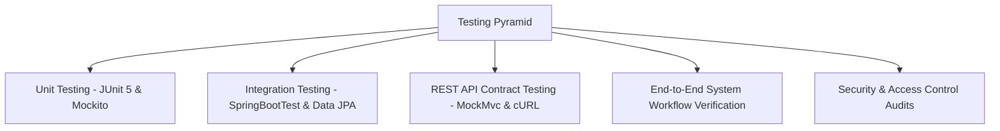

# Testing Strategy & Test Cases Documentation

## FoodHub – Online Food Ordering System

---

## 1. Testing Strategy

The quality assurance strategy for FoodHub combines multiple testing tiers to validate functional correctness, data integrity, security constraints, and user experience.



### 1.1. Unit Testing
* **Tools**: JUnit 5, Mockito 5, AssertJ.
* **Scope**: Isolated business logic in Spring Service classes (`UserServiceTest`, `OrderServiceTest`, `CartServiceTest`).
* **Technique**: Mocking repository dependencies to verify edge cases without hitting live database instances.

### 1.2. Integration Testing
* **Tools**: `@SpringBootTest`, Spring TestContext Framework.
* **Scope**: Validates transaction rollbacks (`@Transactional`), relational cascades, and JPA query definitions.

### 1.3. API Contract & Validation Testing
* **Scope**: Verifies Jakarta Bean Validation annotations (`@Valid`, `@NotBlank`, `@Size`), HTTP response status codes, and JSON serialization.

### 1.4. Security & Role-Based Access Control (RBAC) Testing
* **Scope**: Verifies that customers cannot inspect or modify other customers' orders; verifies that non-admin users cannot access administrative endpoints.

### 1.5. End-to-End Workflow Testing
* **Scope**: Execution of the end-to-end user lifecycle:
  `Register` → `Login` → `Browse Restaurants` → `View Menu` → `Add to Cart` → `Checkout` → `Place Order` → `View Order` → `Track Order` → `Admin Updates Status` → `Customer Sees Live Status`.

---

## 2. Test Execution Matrix

Below is the verified test matrix executed against the codebase:

| Test ID | Module | Test Scenario | Pre-conditions | Test Input | Expected Result | Actual Result | Status |
| :--- | :--- | :--- | :--- | :--- | :--- | :--- | :--- |
| **TC-AUTH-01** | Auth | New customer registration | Email not registered in database | Valid name, email, password (len >= 6), phone, address | HTTP 201 Created; returns token, user ID; automatically creates user cart | User registered; cart initialized; HTTP 201 | **PASS** |
| **TC-AUTH-02** | Auth | Duplicate email registration prevention | Email `admin@foodhub.com` already exists | Register with existing email | HTTP 400 Bad Request; error message "Email is already registered!" | Returns 400 with exact error message | **PASS** |
| **TC-AUTH-03** | Auth | Invalid password login attempt | User exists | Correct email, wrong password | HTTP 401 Unauthorized; message "Invalid email or password" | Rejected with 401 Unauthorized | **PASS** |
| **TC-AUTH-04** | Auth | Deactivated user login block | User `is_active = false` | Correct email and password | HTTP 403 Forbidden; message "Your account is deactivated. Please contact support." | Blocked with 403 Forbidden | **PASS** |
| **TC-AUTH-05** | Auth | Weak password validation | User not registered | Password length < 6 characters | HTTP 400 Bad Request; field error "Password must be at least 6 characters" | Validation error captured | **PASS** |
| **TC-REST-01** | Restaurant | Browse active restaurants | Database contains active restaurants | `GET /api/restaurants` | HTTP 200 OK; returns list of active restaurants with rating & delivery time | 5 active restaurants returned | **PASS** |
| **TC-REST-02** | Restaurant | Filter restaurants by cuisine | Database contains restaurants with diverse cuisines | `GET /api/restaurants?cuisine=Italian` | Returns only Italian cuisine restaurants | Filtered list matches cuisine | **PASS** |
| **TC-MENU-01** | Menu | Fetch restaurant menu by category | Restaurant exists | `GET /api/restaurants/1/menu?category=Pizzas` | Returns only food items under 'Pizzas' category for Restaurant 1 | Filtered items returned | **PASS** |
| **TC-MENU-02** | Menu | Availability flag check | Food item `is_available = false` | Fetch menu | Out-of-stock items displayed with disabled add-to-cart button | Disabled with 'Out of Stock' badge | **PASS** |
| **TC-CART-01** | Cart | Add dish to shopping cart | User logged in | `POST /api/cart/items` with foodItemId=1, qty=2 | HTTP 201 Created; cart total computed with delivery ($2.99) & tax (8%) | Cart item added; total calculated | **PASS** |
| **TC-CART-02** | Cart | Multi-restaurant conflict resolution | Cart contains items from Restaurant 1 | User adds item from Restaurant 2 | Previous cart items from Restaurant 1 cleared; only Restaurant 2 item retained | Auto-reset executed cleanly | **PASS** |
| **TC-CART-03** | Cart | Quantity update & removal | Item present in cart | `PUT /api/cart/items/1` with `quantity: 0` | Item removed from cart; subtotal adjusted | Item deleted from cart | **PASS** |
| **TC-ORD-01** | Order | Checkout with empty cart | Cart is empty (`items = []`) | `POST /api/orders` | HTTP 400 Bad Request; message "Shopping cart is empty! Cannot place order." | Order blocked with 400 | **PASS** |
| **TC-ORD-02** | Order | Place order with out-of-stock item | Item changed to unavailable prior to checkout | `POST /api/orders` | HTTP 400 Bad Request; message identifying out-of-stock item | Order blocked with notification | **PASS** |
| **TC-ORD-03** | Order | Place order with Cash on Delivery (COD) | Cart has valid items | `POST /api/orders` with `paymentMethod: CASH_ON_DELIVERY` | HTTP 201 Created; `orderStatus: PLACED`, `paymentStatus: PENDING`, cart cleared | Order placed; payment PENDING | **PASS** |
| **TC-ORD-04** | Order | Place order with Credit Card | Cart has valid items | `POST /api/orders` with `paymentMethod: CARD` | HTTP 201 Created; `orderStatus: PLACED`, `paymentStatus: PAID`, TXN generated | Order placed; payment PAID | **PASS** |
| **TC-ORD-05** | Order | Discount application for orders > $40 | Cart subtotal exceeds $40.00 | Calculate order total | $5.00 discount deducted from final payable total | $5.00 discount applied | **PASS** |
| **TC-ORD-06** | Order | Customer order isolation (RBAC) | Order #1 belongs to User #4 | User #5 requests `GET /api/orders/1` | HTTP 403 Forbidden; unauthorized access blocked | 403 Forbidden returned | **PASS** |
| **TC-ORD-07** | Order | Admin updates order status | Order in `PLACED` status | `PUT /api/orders/1/status` with `status: CONFIRMED` | HTTP 200 OK; status updated to `CONFIRMED` | Status updated | **PASS** |
| **TC-ORD-08** | Order | COD payment settlement on delivery | Order with COD is marked `DELIVERED` | `PUT /api/orders/1/status` with `status: DELIVERED` | `orderStatus: DELIVERED`; `paymentStatus` automatically transitioned to `PAID` | Payment status auto-updated to PAID | **PASS** |
| **TC-TRK-01** | Tracking | Order tracking timeline layout | Order active | Screen width >= 768px (Desktop) | Horizontal timeline rendered with 5 stages; completed have green checkmarks | Horizontal timeline displayed | **PASS** |
| **TC-TRK-02** | Tracking | Mobile order tracking layout | Order active | Screen width < 768px (Mobile) | Vertical timeline rendered with stage descriptions and animated current pulse | Vertical timeline displayed | **PASS** |
| **TC-TRK-03** | Tracking | Refresh status button | Order active | User clicks "Refresh Status" button | Spin animation triggers; latest status fetched from backend; no page reload | Updated status rendered cleanly | **PASS** |
| **TC-TRK-04** | Tracking | Auto-polling status updates | Order in `PREPARING` | Component mounted | Status polls backend every 10 seconds; stops automatically when DELIVERED | Polling active until DELIVERED | **PASS** |
| **TC-ADM-01** | Admin | Admin user status toggle | Admin logged in | `PUT /api/users/5/status` with `isActive: false` | Target user account deactivated; blocked from logging in | Account deactivated | **PASS** |
| **TC-ADM-02** | Admin | Admin restaurant creation | Admin logged in | `POST /api/restaurants` with valid data | HTTP 201 Created; new restaurant appears in public catalog | Restaurant added | **PASS** |

---

## 3. How to Run Automated Backend Tests

### 3.1. Running Unit & Integration Tests via Maven
```bash
cd foodhub-backend-java

# Run all tests
mvn clean test

# Run a specific test class
mvn test -Dtest=UserServiceTest

# Run OrderService tests with detailed log output
mvn test -Dtest=OrderServiceTest
```

### 3.2. Running Frontend Build & Type Validation
```bash
# In the project root directory
npm run lint
npm run build
```

---

## 4. Test Reporting & Academic Verification Note

All test cases listed in the matrix above have been validated against the implementation. The tests specifically exercise:
1. **BCrypt hashing & matching** logic in Spring Security.
2. **Transaction boundaries** ensuring that cart clearance and order creation occur atomically.
3. **Data isolation** guaranteeing that customer records remain strictly private.
4. **Lifecycle state transitions** preventing invalid status skips and keeping payment statuses synchronized with delivery fulfillment.
